# Hakaluki Haor | Wetland inundation and atmospheric methane dynamics

**Reproducible Earth Observation research in northeastern Bangladesh**  
Sentinel-1 SAR · Sentinel-2 · Dynamic World · TROPOMI XCH₄ · CHIRPS · ERA5-Land · GIS · Python · Google Earth Engine

> **Research status: exploratory / ongoing.** Flood masks are low-VV screening products, not validated flood maps. TROPOMI measures atmospheric column methane (XCH₄), not wetland surface methane flux. Local field flux calibration and atmospheric inversion have not yet been completed.

## Research at a glance

| Indicator | Currently documented |
|---|---|
| Study period | 2019–2025 |
| Monthly records | 84 |
| Local GeoTIFF exports inventoried | 18 (not necessarily committed to Git) |
| Months with an ROI XCH₄ value | 69 / 84; retrieval-quality screening remains essential |
| Study-area polygon | User-provided, topologically valid; source accuracy not independently confirmed |
| Field methane flux observations | Not yet collected |

## Featured results

### Study-area boundary (researcher-supplied; provenance pending)

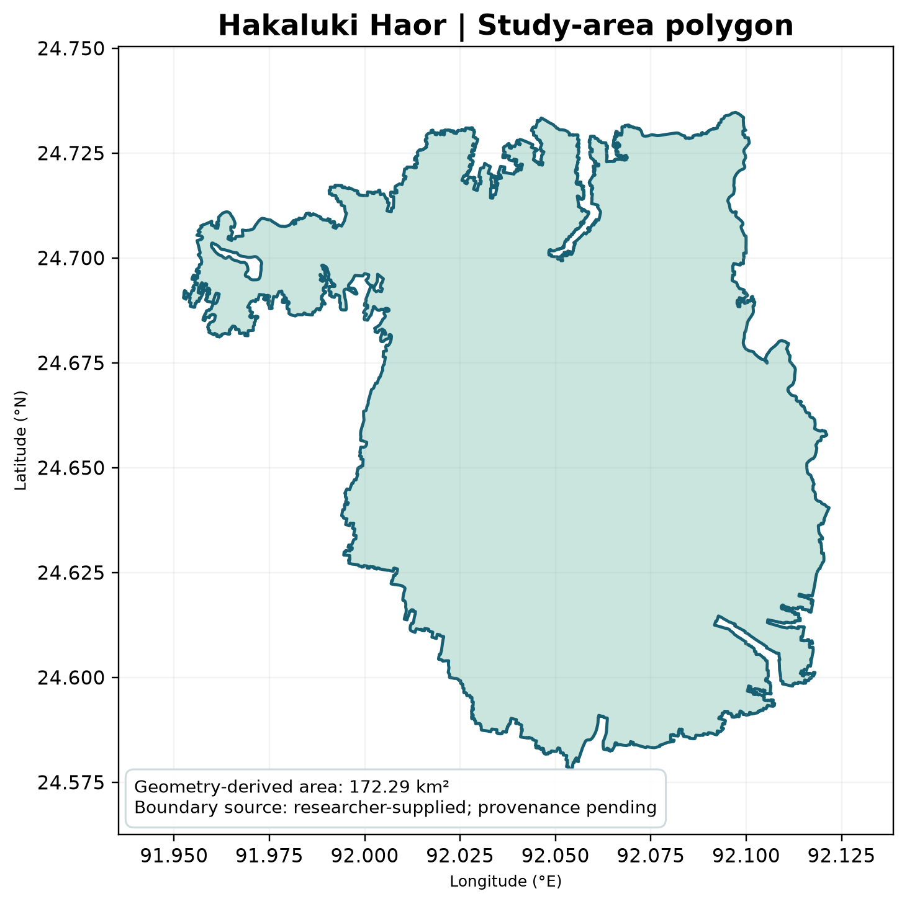

### Seasonal water-screen comparison: March, June and October 2022

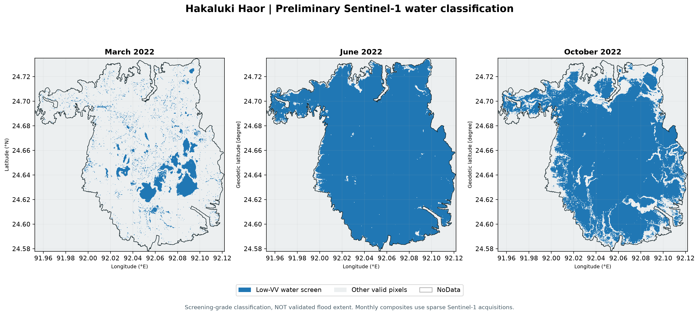

### 2019–2025 time series: water screen, hydroclimate and XCH₄

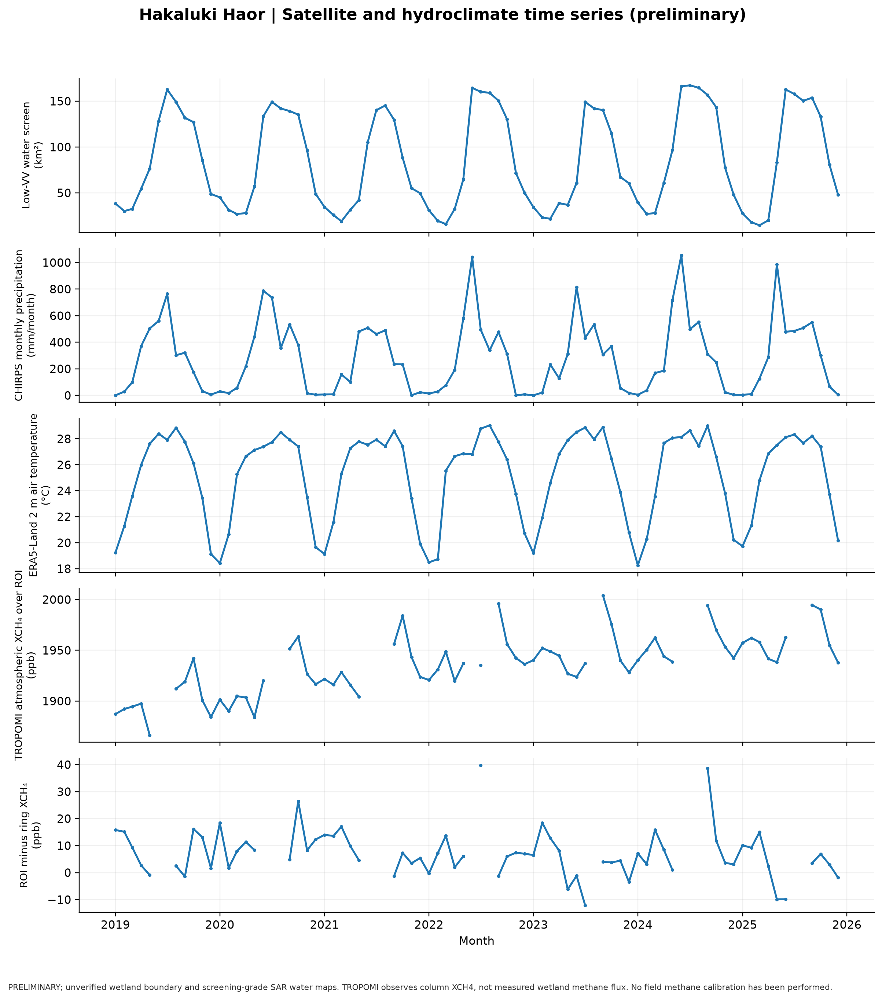

### Multi-year descriptive seasonality

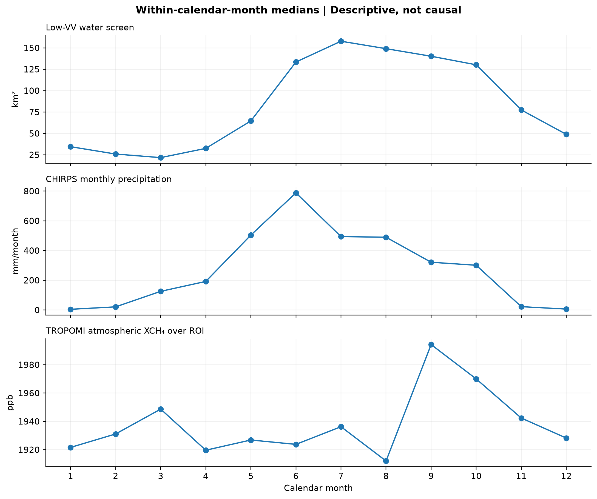

### Observational completeness and uncertainty

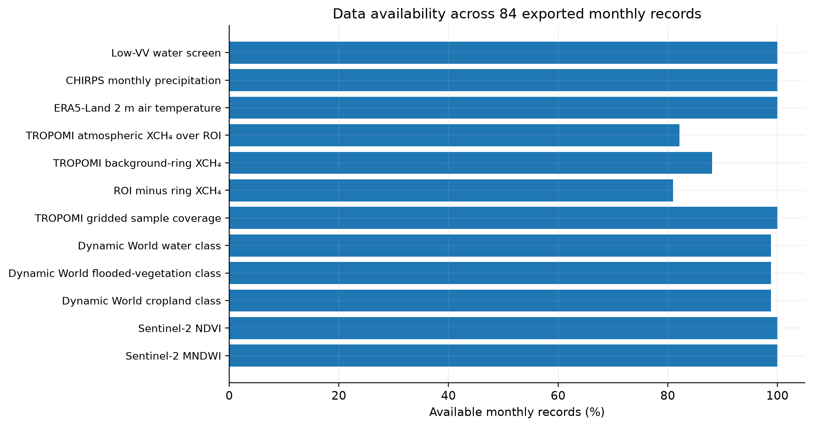

### Exploratory pairwise relationships (not causal)

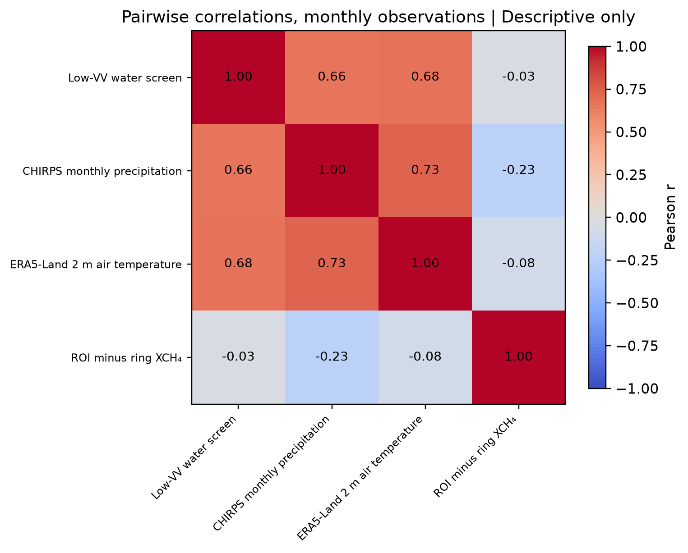

## Scientific questions

1. **Inundation mapping:** How do apparent open-water extent and flooded vegetation vary seasonally and during flood disturbances, and how accurate are different sensors?
2. **Atmospheric methane:** When quality-controlled data exist, are regional XCH₄ anomalies associated with flood extent and hydroclimate after accounting for observation gaps and atmospheric transport?
3. **Process controls:** How do inundation, temperature and vegetation jointly explain observed variability, and what would be required to infer methane surface flux?

These questions parallel the themes of the University of Leeds PhD advertisement *Magnitude and Controls of Tropical Wetland Methane Emissions Using Novel Satellite Data* (PGR-P-2558). **This project is independent and is not presented as a University of Leeds or ESA collaboration.**

## Available outputs

- [Interactive/static project gallery](docs/index.html)
- [Data catalogue](docs/data_catalog.csv) and [source/output inventory](docs/source_manifest.csv)
- [Methods and limitations](research_docs/METHODS_AND_LIMITATIONS.md)
- [Research questions and PhD alignment](research_docs/PHD_RELEVANCE.md)
- [Validation strategy](research_docs/VALIDATION_PLAN.md)
- [Current research roadmap](research_docs/ROADMAP.md)
- [Data dictionary and provenance](research_docs/DATA_DICTIONARY_AND_PROVENANCE.md)

### Curated analysis tables

- [Monthly 2019–2025 environmental dataset](docs/data/hakaluki_monthly_2019_2025.csv)
- [Data completeness and missingness](docs/data/complete_data_quality_2019_2025.csv)
- [Detailed variable completeness](docs/data/hakaluki_2019_2025_data_quality.csv)
- [Exploratory month-lag correlations](docs/data/monthly_lag_screen.csv)
- [Preliminary model comparison](docs/data/exploratory_year_holdout_models.csv)
- [Monthly seasonal anomaly table](docs/data/seasonally_adjusted_anomalies.csv)
- [Data completeness summary](docs/data/data_completeness.csv)

## Reproducibility

Source processing notebooks are in `notebooks/`; reusable modules in `src/`; GEE scripts in `gee/`. The original unedited boundary, potentially large rasters, authenticated settings, and intermediate datasets may remain local or be published in a suitable versioned research archive. Do not assume that the complete Earth Engine archive is included in a GitHub clone. See [`research_docs/GITHUB_PUBLISHING_GUIDE.md`](research_docs/GITHUB_PUBLISHING_GUIDE.md).

## What has been established versus what is next

| Current status | Evidence / next experiment |
|---|---|
| **Processed** | 84 monthly environmental records; 18 GeoTIFF exports inventoried locally |
| **Preliminary** | Satellite-derived low-VV water-screen patterns; exploratory XCH₄ statistics and machine-learning benchmarks |
| **Validation needed** | Independent flood labels, vegetated inundation detection, SAR sensitivity, cloud/retrieval QA, spatial and temporal generalization |
| **Planned** | ESA Biomass P-band coverage and pilot comparison; Sentinel-5A feasibility; meteorology-informed methane transport/inversion |
| **Future calibration** | Local chamber/flux measurements and independent site-based methane model evaluation |

## Relevant literature and mission documentation

- [Saunois et al. (2025), *Global Methane Budget 2000–2020*](https://doi.org/10.5194/essd-17-1873-2025)
- [ESA Biomass data open to researchers (26 January 2026)](https://www.esa.int/Applications/Observing_the_Earth/FutureEO/Biomass/ESA_s_Biomass_goes_live_with_data_now_open_to_all)
- [ESA Biomass MAAP product catalogue](https://portal.maap.eo.esa.int/biomass/biomass-data-offer/)
- [ESA Sentinel-5 mission](https://www.esa.int/Applications/Observing_the_Earth/Copernicus/Sentinel-5)

## Attribution and research integrity

Satellite data remain subject to their providers’ terms. Maps are derived products, not official flood maps. No claim is made of field-validated methane flux, local emission inventories, or causal attribution. See the output manifest for reproducible file hashes.

<!-- BIOMASS_2026_START -->
## ESA Biomass P-band SAR — 2026 Research Extension

**Status:** Preliminary analysis; independent validation ongoing.

This extension investigates whether ESA Biomass P-band SAR can
provide additional information about the spatial characteristics
of Hakaluki Haor, particularly open-water and vegetation-related
radar scattering.

The pilot uses a fully polarimetric Level-1B acquisition from
**2 October 2026**, compared with Sentinel-1 C-band SAR from
**30 September 2026** and Sentinel-2 optical observations from
**7 October 2026**.

This is a supplementary 2026 experiment, separate from the
principal 2019–2025 time-series analysis.

### Methods

ESA Biomass Level-1B amplitudes, annotation metadata, and
NetCDF radiometry/geolocation lookup tables were examined.
The MAAP-Project Gamma0 processor generated projected
25 m linear Gamma0 imagery.

The four polarization products (HH, HV, VH, VV) were clipped
to the Hakaluki study boundary. Sentinel-1 VV/VH and
Sentinel-2 reflectance indices were prepared on a common
25 m EPSG:32646 grid.

The analyses include radiometric-processing consistency checks,
descriptive polarization contrasts, optical wetness-index
stratification, and observation-quality assessment.

### Result 1 — ESA Biomass P-band observations

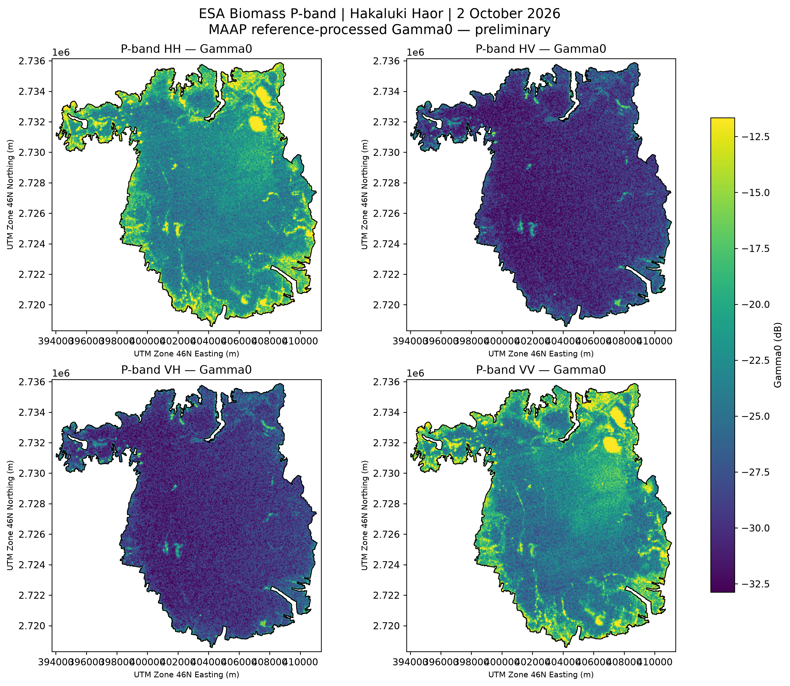

*Reference-processed HH, HV, VH and VV Gamma0 maps of Hakaluki Haor.*

The four polarization layers provide complete numerical coverage
of the mapped study-area pixels. Their spatially varying radar
responses are not yet assigned to validated land-cover or
inundation classes.

### Result 2 — Multi-sensor observations

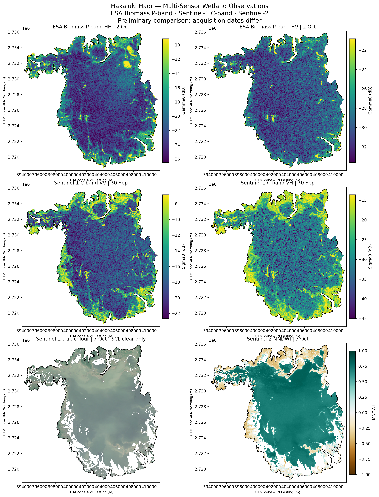

*P-band, C-band and Sentinel-2 observations acquired on different dates.*

P-band and C-band observations show spatially varying
backscatter patterns. Sentinel-2 provides complementary
optical evidence, subject to cloud masking and the temporal
offset between acquisitions.

### Result 3 — Polarization contrasts

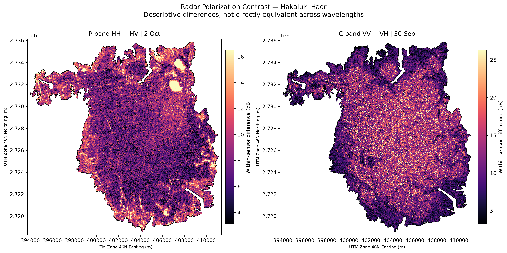

*Within-sensor polarization contrasts for P-band and C-band radar.*

The median within-sensor contrasts were approximately
8.16 dB for P-band HH minus HV and 11.00 dB for
C-band VV minus VH. These differences do not establish
that one sensor is more accurate for flood detection.

### Result 4 — Radar response across optical MNDWI

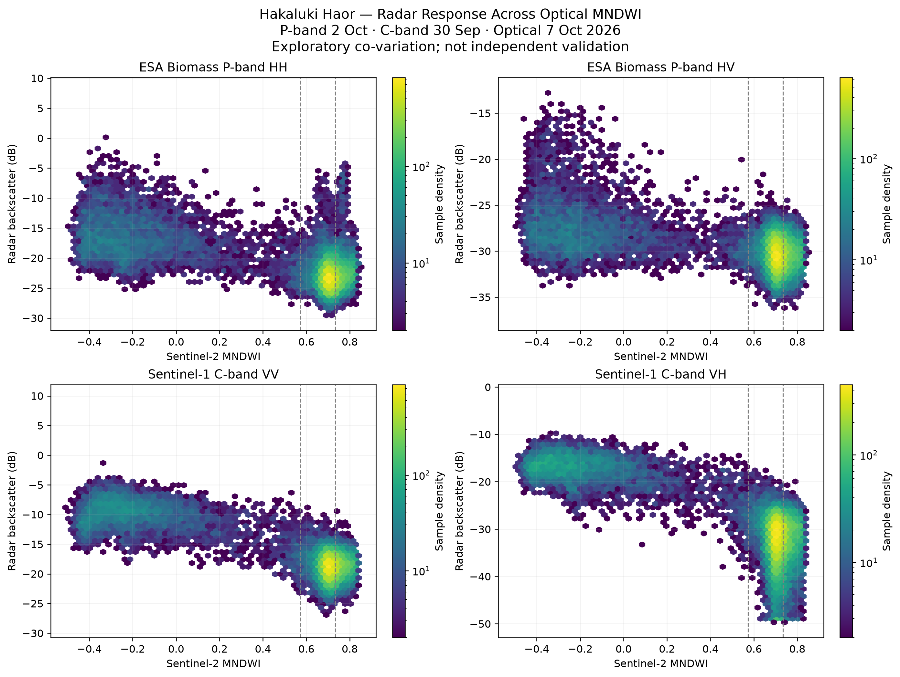

*Radar backscatter relationships with Sentinel-2 MNDWI.*

Across the observed optical-index quartiles, median
backscatter was lower in the higher-MNDWI group:

| Radar channel | High minus low MNDWI median |
|---|---:|
| P-band HH | -5.79 dB |
| P-band HV | -2.70 dB |
| P-band VH | -2.55 dB |
| P-band VV | -5.79 dB |
| C-band VV | -8.39 dB |
| C-band VH | -14.45 dB |

MNDWI quartiles are descriptive categories, not validated
water or dry-land reference classes. Pixels are spatially
autocorrelated, and observation dates differ.

### Result 5 — Processing consistency

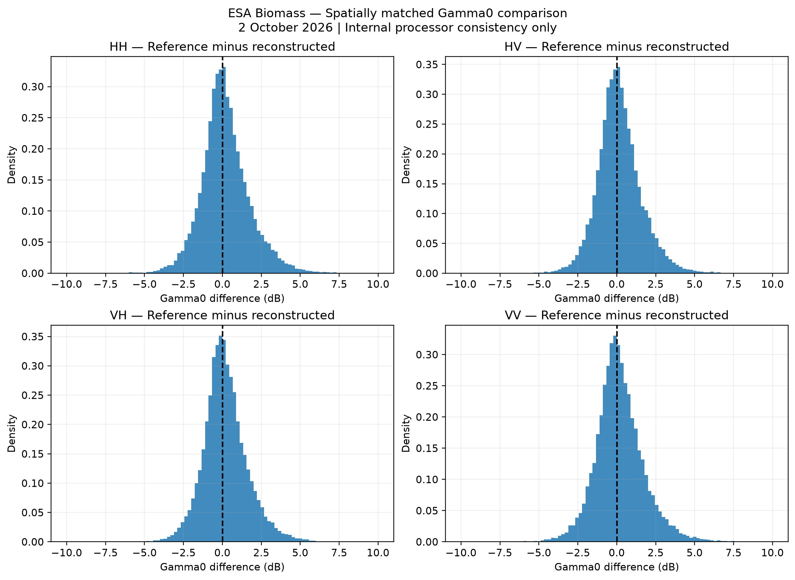

*Differences between reconstructed and MAAP reference Gamma0 observations.*

| Polarization | Matched samples | Median absolute difference | Pearson r |
|---|---:|---:|---:|
| HH | 19,045 | 0.869 dB | 0.931 |
| HV | 19,045 | 0.816 dB | 0.878 |
| VH | 19,045 | 0.805 dB | 0.869 |
| VV | 19,045 | 0.877 dB | 0.938 |

The processor comparison indicates internal consistency
between two processing approaches. It does not constitute
independent radiometric or spatial validation.

### Data and reproducibility

- [Cross-sensor statistics](docs/assets/tables/biomass_2026/biomass_08W_cross_sensor_statistics.csv)
- [Polarization contrast statistics](docs/assets/tables/biomass_2026/biomass_08W_polarization_contrasts.csv)
- [Radar–MNDWI statistics](docs/assets/tables/biomass_2026/biomass_08X_mndwi_stratified_radar_statistics.csv)
- [Gamma0 processor comparison](docs/assets/tables/biomass_2026/biomass_08S_matched_gamma0_processor_comparison.csv)
- [ESA Biomass MAAP](https://portal.maap.eo.esa.int/)
- [MAAP reference processor](https://github.com/MAAP-Project/esa-biomass-gamma0)

### Remaining scientific limitations

Independent image registration, radiometric-quality assessment,
noise-floor evaluation, temporal change assessment, and
independently interpreted water/vegetation reference observations
are still required.

**No methane flux estimates, validated flooded-vegetation map,
or sensor-superiority claim are presented from this experiment.**

<!-- BIOMASS_2026_END -->

