# Hakaluki Haor | Wetland inundation, hydroclimate and atmospheric methane

**Independent Earth-observation research in northeastern Bangladesh**  
**Main study:** January 2019–December 2025 | **Separate P-band SAR pilot:** October 2026  
Sentinel-1 · Sentinel-2 · ESA Biomass P-band · TROPOMI XCH4 · CHIRPS · ERA5-Land · GIS · Google Earth Engine · Python

> **Research status: exploratory; independent scientific validation outstanding.** The radar-derived maps are **low-VV backscatter screening products, not verified flood maps**. TROPOMI measures atmospheric column methane (XCH4, ppb), **not wetland methane emission flux**. No field methane-flux validation, atmospheric inversion, or causal attribution has been completed.

## Main findings — and their boundaries

The most informative outcome is **not a measured methane release**. Rather, we observed (a) unusually extensive low-VV detections coinciding with exceptional rainfall during June 2022 and (b) **scarce TROPOMI XCH4 observations during months of greatest low-VV screening extent**, making a direct methane response difficult to investigate.

| Research component | What the completed local analysis reports | What it does **not** prove |
|---|---|---|
| Radar observation support | **84/84 months** with Sentinel-1 on one ascending track (relative orbit 41), 214 scenes; one single-scene month | Independent accuracy of a water/flood classification |
| June 2022 low-VV area | **162.78 km²**, versus **120.10 km²** median of the other six Junes (**+42.68 km²**) at nominal −17 dB | Verified flooded-water area |
| June 2022 spatial low-VV departure | **+42.16 km²** net screening-frequency-equivalent difference from the **mean** historical June map | A second independent flood-area estimate |
| June 2022 CHIRPS rainfall | **1,041.35 mm**, **+367.17 mm** above other-June median | Causal proof of flood dynamics |
| Deseasonalized climate link | Preceding-three-month rainfall sum vs. low-VV area: **Spearman rho +0.524**, n = 81 | Hydrological mechanism or causal response lag |
| Year-held-out prediction | Climate Ridge: **RMSE 17.45 km²** vs. seasonal baseline **19.15**; Ridge **MAE 13.65** vs. baseline **13.26** | Consistent performance improvement across years |
| TROPOMI methane availability | ROI XCH4 in **69/84 months**; only **3/7 Junes**, **2/7 Julys**, **1/7 Augusts** | Representative year-round atmospheric methane measurements |
| Conditional observation availability | XCH4 present in **21/21** lowest-low-VV-quartile months; only **8/21** highest-quartile months | Causal link between surface wetness and satellite retrieval failure |
| Methane association | Available-month deseasonalized rank correlations near **zero** | Evidence that methane emissions are unaffected by inundation |
| ESA Biomass polarimetry | Four 25 m Gamma0 P-band layers; descriptive comparison with C-band and Sentinel-2 | Superior P-band flood-detection accuracy |

**Read the detailed research findings, non-findings and remaining work:** [Findings and limitations, 2019–2025](research_docs/FINDINGS_2019_2025_AND_LIMITATIONS.md).

**Public-reproducibility status:** The precise results above were reported from completed **local** Jupyter Notebook 09–11 runs. **Notebooks 09–11, 14 figures, 26 tables/manifests and two scientific reports are now published on GitHub.** Published older 2022 visualizations may use a different screening method; they should not be assumed equivalent to the fixed −17 dB 2019–2025 series. Local execution logs are not a substitute for independent validation.

## What is important scientifically

### June 2022: unusual radar screening extent, not a validated flood boundary

In June 2022, the nominal low-VV detection area was **162.775 km²**, about **42.676 km² higher** than the median June total in the six comparison years. The spatial June comparison gave **+42.164 km²** when the binary 2022 indicator was contrasted with the *mean per-pixel frequency* of other Junes. These are **different descriptive statistics**. Neither is independently validated extra inundation. June rainfall was substantially above the other-June median.

A single track with 1–3 scenes per month does not resolve exact flash-flood timing, permanent water versus transient inundation, or flooded vegetation. The VV cutoff is a screening threshold requiring independent calibration.

### Rainfall: a possible antecedent-wetness association, mixed prediction

After calendar-month adjustment, nominal low-VV deviations were descriptively associated with **same-month rainfall (rho +0.232)**, **one-month-lag rainfall (+0.428)** and **preceding-three-month rainfall (+0.524)**. However, a month + rainfall/temperature Ridge model did not consistently beat the simpler month-median baseline in leave-one-year-out validation. The June 2022 out-of-year model left a **+39.26 km² low-VV residual**. Neither correlation nor residual identifies a particular causal driver.

### Atmospheric methane: observation gaps obstruct the key event

TROPOMI-derived ROI XCH4 was available for 69/84 monthly periods, but only 3/7 Junes and 1/7 Augusts. **June 2022 has no valid monthly ROI XCH4 value in our Level-3-derived dataset**. Availability was **100%** for the lowest 21 low-VV months, versus **38.1%** for the highest 21. This is significant **descriptive sampling imbalance**, but seasonal cloud/weather and acquisition/retrieval conditions may confound it.

Available-month, calendar-month-deseasonalized Spearman correlations were near zero across tested support levels: about **−0.052 to −0.013** for ROI XCH4 and **+0.026 to +0.049** for ROI-minus-reference-ring XCH4. The respective complete-case analyses used **62–66 months**, fewer than the 69 with a simple ROI methane value; missing-row exclusions warrant audit.

**We cannot conclude that inundation did or did not alter wetland methane emissions.** XCH4 is an atmospheric column concentration influenced by transport and regional sources, and native Level-2 footprint/retrieval QA checks remain outstanding.

## Visual results already published on GitHub

The following figures are from the **earlier exploratory workflow**, and may use different screening definitions from Notebook 09. The 14 **newer Notebook 09–11 figures** are embedded in the [updated results gallery](#updated-20192025-results-published-source-files).

### Hakaluki Haor study area

### Earlier March–June–October 2022 low-backscatter screening maps

### Monthly Earth-observation series, 2019–2025

### Data completeness and seasonal patterns

### Early exploratory covariate associations (not causal)

**Newly published figures, embedded in the results gallery below:** `inundation09_annual_lowvv_frequency_2019_2025.png`, `inundation09_june2022_spatial_lowvv_departure.png`, `hydro10_2022_radar_rainfall_departures.png`, `hydro10_deseasonalized_lag_associations.png`, `methane11_observation_selection_bias.png`, `methane11_coverage_sensitive_scatter.png`.

The [publishing helper](tools/publish_notebooks_09_11.py) was used to commit these figures; it can synchronize future regenerated outputs.

## What we cannot claim yet

| Critical gap | Work needed |
|---|---|
| **Validated flood area / flooded vegetation** | Independent high-resolution reference imagery and/or field observations; threshold and orbit sensitivity; confusion matrices and area uncertainty |
| **Confirmed 2022 flash-flood onset or cause** | Event-scale radar acquisition timing, rain/gauge/water-level evidence, control for seasonal or permanent water |
| **Local methane emission rates** | Flux measurements or defensible atmospheric inversion; XCH4 alone cannot supply flux |
| **Reliable methane response to June 2022** | Native TROPOMI Level-2 QA, real retrieval footprints, cloud/aerosol filters, wind and source-transport diagnostics; June 2022 Level-3 ROI value currently missing |
| **Generalizable climate prediction** | Stronger held-out evaluation, uncertainty and alternative baselines; avoid overfitting seven years of data |
| **P-band superiority** | Independent water/flooded vegetation labels, noise-floor studies, compatible calibration, temporal/geometry controls |
| **Independent reproduction** | Code, tables, figures, manifests and reports are published. An independent end-to-end rerun and validation remain to be done. |

## Research questions and methods

1. How does radar low-backscatter screening vary from 2019 to 2025, and how accurately can it identify actual open water and flooded vegetation?
2. How do rainfall timing, antecedent wetness and air temperature relate to the radar time series after accounting for month-of-year seasonality?
3. How does wet-season methane retrieval missingness affect what can be inferred from satellite XCH4 observations?
4. Can ESA Biomass P-band polarimetry add independently demonstrated wetland information beyond Sentinel-1 C-band?
5. What field, transport and inversion evidence is required to estimate methane **emissions**?

**Source and method navigation:** [Full findings](research_docs/FINDINGS_2019_2025_AND_LIMITATIONS.md) · [Methods and limitations](research_docs/METHODS_AND_LIMITATIONS.md) · [Validation plan](research_docs/VALIDATION_PLAN.md) · [Development roadmap](research_docs/ROADMAP.md) · [Data provenance](research_docs/DATA_DICTIONARY_AND_PROVENANCE.md).

## Notebook 09–11 reproducible source code

- [09 — Consistent-orbit 2019–2025 low-VV screening](notebooks/09_inundation_dynamics_2019_2025_QA_v3_export_fixed.ipynb)
- [10 — Hydroclimatic controls and held-out modelling](notebooks/10_hydroclimatic_controls_2019_2025.ipynb)
- [11 — TROPOMI atmospheric methane observation QA](notebooks/11_tropomi_methane_qa_2019_2025.ipynb)
- [Publish locally executed figures, tables and reports](tools/publish_notebooks_09_11.py)

**Notebooks and executed result files are published; independent scientific re-execution and validation remain outstanding.**

## Available data and reproducibility

- [Published 2019–2025 monthly environmental table](docs/data/hakaluki_monthly_2019_2025.csv) — original processing, not a substitute for the later Notebook 09 reanalysis.
- [Observation completeness table](docs/data/complete_data_quality_2019_2025.csv).
- [Earlier exploratory lag results](docs/data/monthly_lag_screen.csv) and [year-held-out models](docs/data/exploratory_year_holdout_models.csv); methods may differ from Notebook 10.
- Public `notebooks/` includes **00–11**; selected outputs are available below and in `docs/assets/` and `research_docs/reports/`. Reusable code is under `src/` and `gee/`.
- Selected study boundary files, derived figures and Biomass cross-sensor statistical tables are published; some raw scenes, large intermediate rasters and Earth Engine data collections remain outside Git. See [safe publishing guidance](research_docs/GITHUB_PUBLISHING_GUIDE.md).

**Research integrity:** Independent researcher-led project, thematically related to the University of Leeds PhD topic *Magnitude and Controls of Tropical Wetland Methane Emissions Using Novel Satellite Data* (PGR-P-2558), **not** a University of Leeds or ESA collaboration. No official flood map, independently calibrated methane flux, or causal attribution is claimed.

---

<!-- LOCAL_2019_2025_RESULTS_START -->
## Updated 2019–2025 results: published source files

These figures and tables come from local Notebooks 09–11 and remain **exploratory observations**, not independent validation of inundation, methane flux, or causation.

### Monthly low-VV screening, 2019–2025

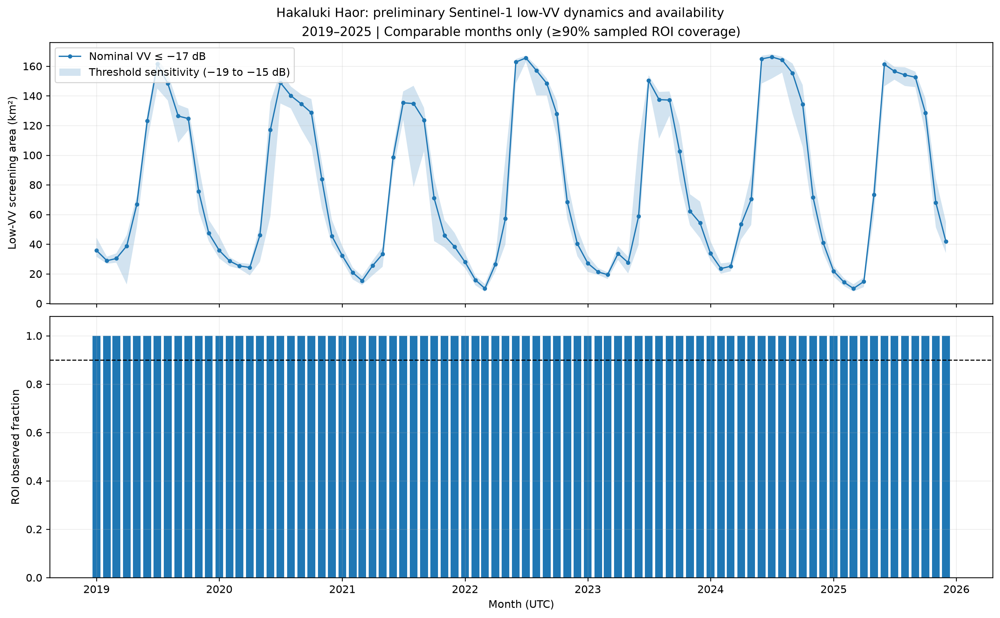

*Low-VV detections are not validated flooded-water area.*

### Low-VV detections by calendar month and year

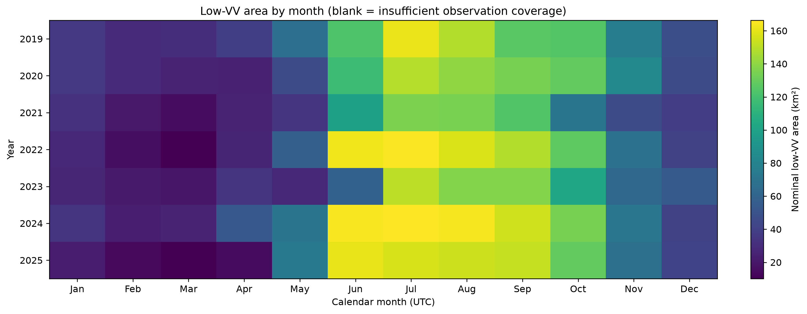

*A fixed VV threshold was used; color is an unvalidated screening statistic.*

### 2022 monthly differences relative to other years

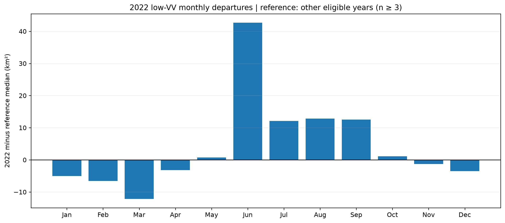

*Differences compare screening areas, not confirmed additional floodwater.*

### Annual observation-normalized low-VV occurrence, 2019–2025

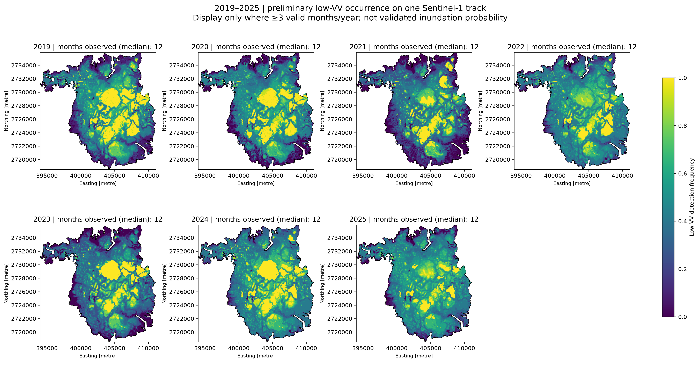

*The denominator is the number of valid observed months per pixel; not an inundation probability.*

### June 2022 spatial difference from historical June screening frequency

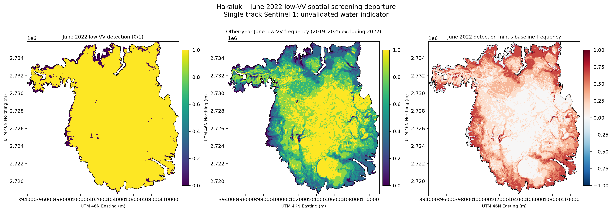

*Per-pixel binary-minus-frequency departure; not a flood-area-change map.*

### Rainfall, temperature and low-VV screening series

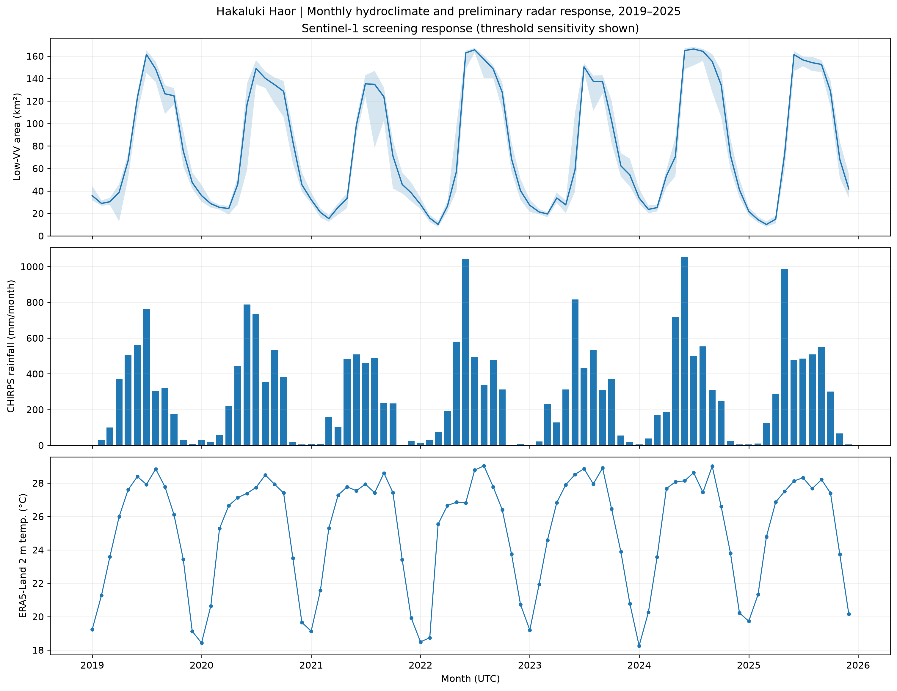

*Monthly covariates, not causal drivers or flood verification.*

### Seasonal cycle of hydroclimate and low-VV screening

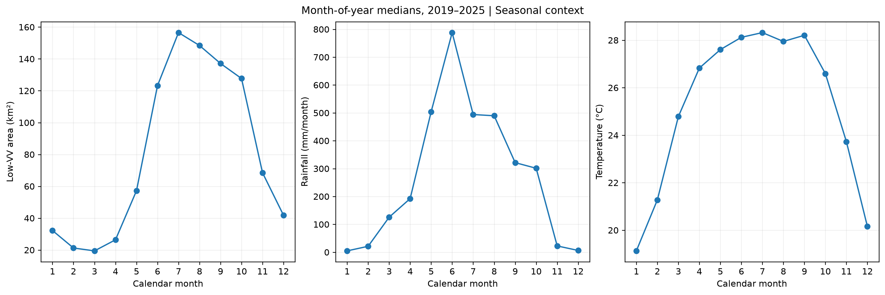

*Descriptive monthly aggregation.*

### 2022 radar and rainfall departures

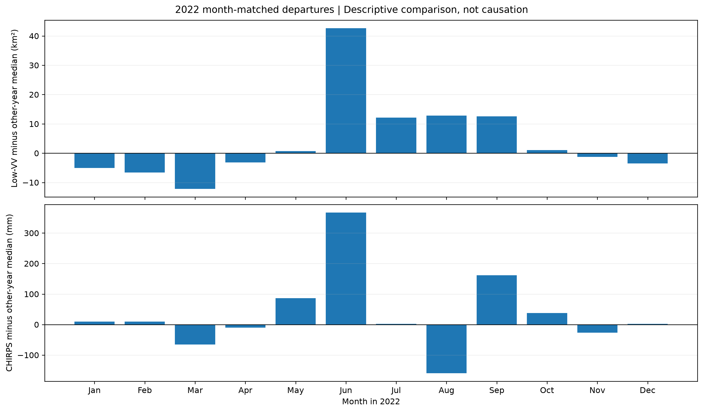

*Coincidence does not establish causal flooding.*

### Deseasonalized hydroclimatic associations

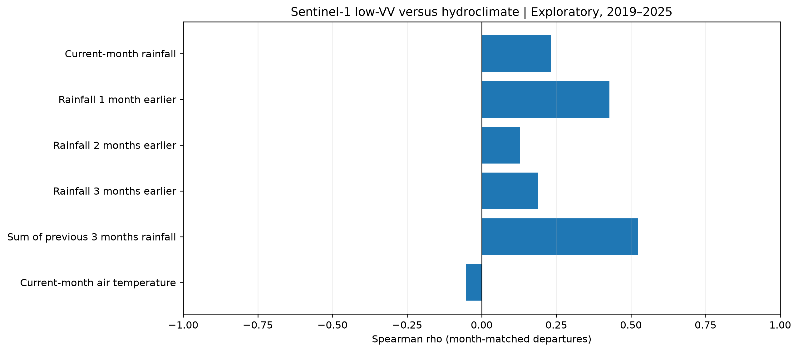

*Serial correlation and multiple comparisons limit inference.*

### Out-of-year climate-model hindcasts versus seasonal baseline

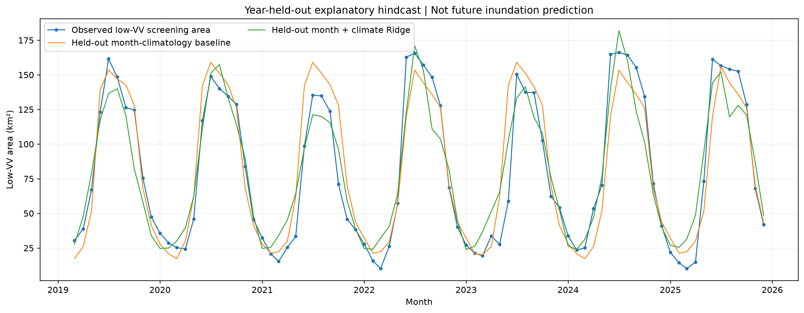

*Predictive performance is mixed across years.*

### TROPOMI XCH4 month-by-month availability and Level-3 grid support

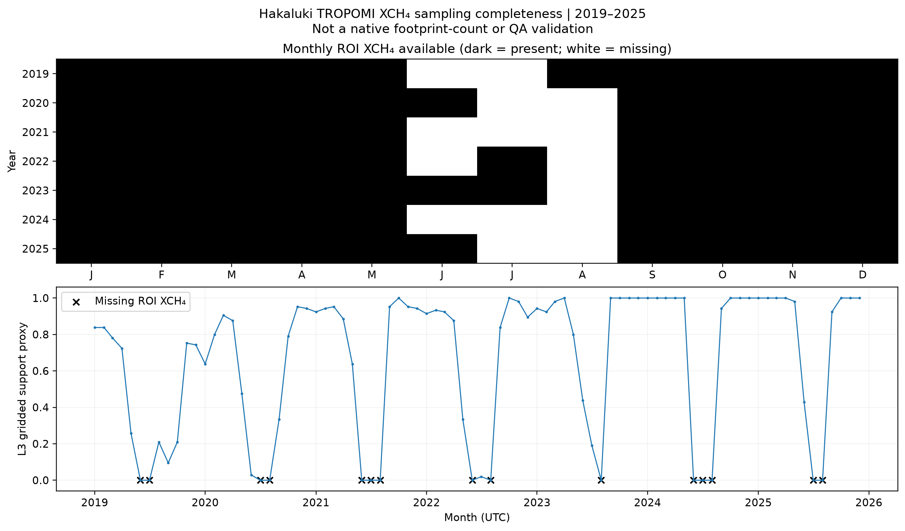

*Level-3 coverage does not equal native Level-2 retrieval footprints.*

### Atmospheric XCH4 inside the ROI and in a reference ring

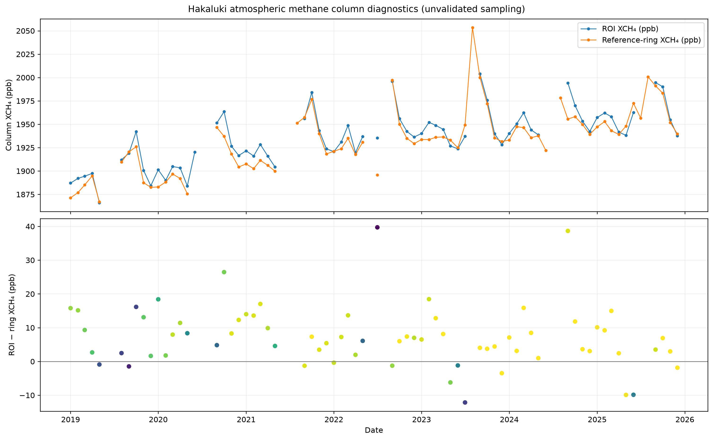

*Column concentrations are not local methane emissions.*

### Methane observation availability across low-VV screening conditions

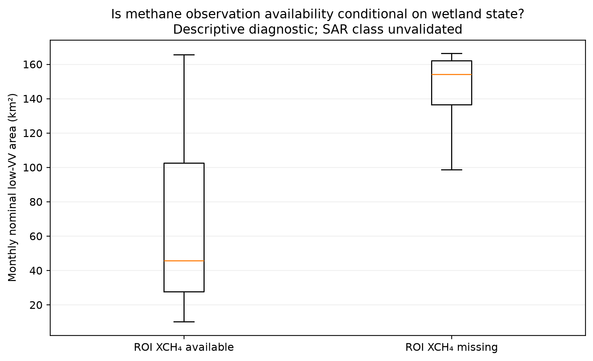

*Wet-season missingness creates observational selection bias.*

### Available-month XCH4 versus low-VV anomalies

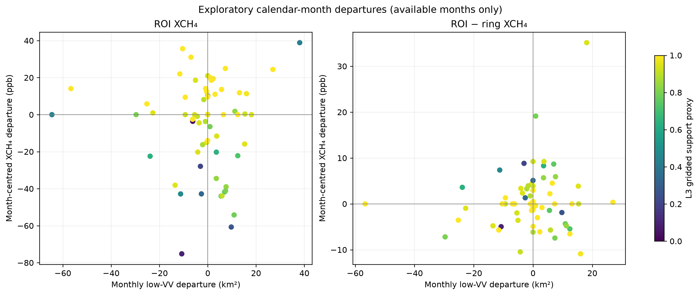

*Near-zero associations cannot rule out wetland methane flux responses.*

### Reproducible analysis notebooks

- [09_inundation_dynamics_2019_2025_QA_v2.ipynb](notebooks/09_inundation_dynamics_2019_2025_QA_v2.ipynb)
- [10_hydroclimatic_controls_2019_2025.ipynb](notebooks/10_hydroclimatic_controls_2019_2025.ipynb)
- [11_tropomi_methane_qa_2019_2025.ipynb](notebooks/11_tropomi_methane_qa_2019_2025.ipynb)

### Scientific interpretation reports

- [NOTEBOOK10_HYDROCLIMATE_FINDINGS.md](research_docs/reports/NOTEBOOK10_HYDROCLIMATE_FINDINGS.md)
- [NOTEBOOK11_TROPOMI_QA_FINDINGS.md](research_docs/reports/NOTEBOOK11_TROPOMI_QA_FINDINGS.md)

### Analysis result tables

- [inundation09_s1_scene_inventory.csv](docs/assets/tables/analysis_2019_2025/inundation09_s1_scene_inventory.csv)
- [inundation09_track_selection.csv](docs/assets/tables/analysis_2019_2025/inundation09_track_selection.csv)
- [inundation09_processing_parameters.json](docs/assets/tables/analysis_2019_2025/inundation09_processing_parameters.json)
- [inundation09_monthly_2019_2025.csv](docs/assets/tables/analysis_2019_2025/inundation09_monthly_2019_2025.csv)
- [inundation09_annual_coverage_qa.csv](docs/assets/tables/analysis_2019_2025/inundation09_annual_coverage_qa.csv)
- [inundation09_2022_month_matched_departures.csv](docs/assets/tables/analysis_2019_2025/inundation09_2022_month_matched_departures.csv)
- [inundation09_annual_raster_coverage_qa.csv](docs/assets/tables/analysis_2019_2025/inundation09_annual_raster_coverage_qa.csv)
- [inundation09_june2022_spatial_qa.csv](docs/assets/tables/analysis_2019_2025/inundation09_june2022_spatial_qa.csv)
- [inundation09_june2022_spatial_summary.csv](docs/assets/tables/analysis_2019_2025/inundation09_june2022_spatial_summary.csv)
- [inundation09_run_manifest.json](docs/assets/tables/analysis_2019_2025/inundation09_run_manifest.json)
- [hydro10_merged_monthly_2019_2025.csv](docs/assets/tables/analysis_2019_2025/hydro10_merged_monthly_2019_2025.csv)
- [hydro10_annual_input_qa.csv](docs/assets/tables/analysis_2019_2025/hydro10_annual_input_qa.csv)
- [hydro10_monthly_seasonal_climatology.csv](docs/assets/tables/analysis_2019_2025/hydro10_monthly_seasonal_climatology.csv)
- [hydro10_2022_month_matched_departures.csv](docs/assets/tables/analysis_2019_2025/hydro10_2022_month_matched_departures.csv)
- [hydro10_deseasonalized_associations.csv](docs/assets/tables/analysis_2019_2025/hydro10_deseasonalized_associations.csv)
- [hydro10_leave_year_out_predictions.csv](docs/assets/tables/analysis_2019_2025/hydro10_leave_year_out_predictions.csv)
- [hydro10_leave_year_out_model_metrics.csv](docs/assets/tables/analysis_2019_2025/hydro10_leave_year_out_model_metrics.csv)
- [hydro10_2022_context_and_heldout_residuals.csv](docs/assets/tables/analysis_2019_2025/hydro10_2022_context_and_heldout_residuals.csv)
- [hydro10_processing_manifest.json](docs/assets/tables/analysis_2019_2025/hydro10_processing_manifest.json)
- [methane11_annual_availability.csv](docs/assets/tables/analysis_2019_2025/methane11_annual_availability.csv)
- [methane11_monthly_availability.csv](docs/assets/tables/analysis_2019_2025/methane11_monthly_availability.csv)
- [methane11_seasonal_availability.csv](docs/assets/tables/analysis_2019_2025/methane11_seasonal_availability.csv)
- [methane11_selection_bias_strata.csv](docs/assets/tables/analysis_2019_2025/methane11_selection_bias_strata.csv)
- [methane11_coverage_sensitive_associations.csv](docs/assets/tables/analysis_2019_2025/methane11_coverage_sensitive_associations.csv)
- [methane11_monthly_qa_joined.csv](docs/assets/tables/analysis_2019_2025/methane11_monthly_qa_joined.csv)
- [methane11_qa_manifest.json](docs/assets/tables/analysis_2019_2025/methane11_qa_manifest.json)
<!-- LOCAL_2019_2025_RESULTS_END -->

<!-- BIOMASS_2026_START -->
## ESA Biomass P-band SAR — 2026 Research Extension

**Status:** Preliminary analysis; independent validation ongoing.

This extension investigates whether ESA Biomass P-band SAR can
provide additional information about the spatial characteristics
of Hakaluki Haor, particularly open-water and vegetation-related
radar scattering.

The pilot uses a fully polarimetric Level-1B acquisition from
**2 October 2026**, compared with Sentinel-1 C-band SAR from
**30 September 2026** and Sentinel-2 optical observations from
**7 October 2026**.

This is a supplementary 2026 experiment, separate from the
principal 2019–2025 time-series analysis.

### Methods

ESA Biomass Level-1B amplitudes, annotation metadata, and
NetCDF radiometry/geolocation lookup tables were examined.
The MAAP-Project Gamma0 processor generated projected
25 m linear Gamma0 imagery.

The four polarization products (HH, HV, VH, VV) were clipped
to the Hakaluki study boundary. Sentinel-1 VV/VH and
Sentinel-2 reflectance indices were prepared on a common
25 m EPSG:32646 grid.

The analyses include radiometric-processing consistency checks,
descriptive polarization contrasts, optical wetness-index
stratification, and observation-quality assessment.

### Result 1 — ESA Biomass P-band observations

*Reference-processed HH, HV, VH and VV Gamma0 maps of Hakaluki Haor.*

The four polarization layers provide complete numerical coverage
of the mapped study-area pixels. Their spatially varying radar
responses are not yet assigned to validated land-cover or
inundation classes.

### Result 2 — Multi-sensor observations

*P-band, C-band and Sentinel-2 observations acquired on different dates.*

P-band and C-band observations show spatially varying
backscatter patterns. Sentinel-2 provides complementary
optical evidence, subject to cloud masking and the temporal
offset between acquisitions.

### Result 3 — Polarization contrasts

*Within-sensor polarization contrasts for P-band and C-band radar.*

The median within-sensor contrasts were approximately
8.16 dB for P-band HH minus HV and 11.00 dB for
C-band VV minus VH. These differences do not establish
that one sensor is more accurate for flood detection.

### Result 4 — Radar response across optical MNDWI

*Radar backscatter relationships with Sentinel-2 MNDWI.*

Across the observed optical-index quartiles, median
backscatter was lower in the higher-MNDWI group:

| Radar channel | High minus low MNDWI median |
|---|---:|
| P-band HH | -5.79 dB |
| P-band HV | -2.70 dB |
| P-band VH | -2.55 dB |
| P-band VV | -5.79 dB |
| C-band VV | -8.39 dB |
| C-band VH | -14.45 dB |

MNDWI quartiles are descriptive categories, not validated
water or dry-land reference classes. Pixels are spatially
autocorrelated, and observation dates differ.

### Result 5 — Processing consistency

*Differences between reconstructed and MAAP reference Gamma0 observations.*

| Polarization | Matched samples | Median absolute difference | Pearson r |
|---|---:|---:|---:|
| HH | 19,045 | 0.869 dB | 0.931 |
| HV | 19,045 | 0.816 dB | 0.878 |
| VH | 19,045 | 0.805 dB | 0.869 |
| VV | 19,045 | 0.877 dB | 0.938 |

The processor comparison indicates internal consistency
between two processing approaches. It does not constitute
independent radiometric or spatial validation.

### Data and reproducibility

- [Cross-sensor statistics](docs/assets/tables/biomass_2026/biomass_08W_cross_sensor_statistics.csv)
- [Polarization contrast statistics](docs/assets/tables/biomass_2026/biomass_08W_polarization_contrasts.csv)
- [Radar–MNDWI statistics](docs/assets/tables/biomass_2026/biomass_08X_mndwi_stratified_radar_statistics.csv)
- [Gamma0 processor comparison](docs/assets/tables/biomass_2026/biomass_08S_matched_gamma0_processor_comparison.csv)
- [ESA Biomass MAAP](https://portal.maap.eo.esa.int/)
- [MAAP reference processor](https://github.com/MAAP-Project/esa-biomass-gamma0)

### Remaining scientific limitations

Independent image registration, radiometric-quality assessment,
noise-floor evaluation, temporal change assessment, and
independently interpreted water/vegetation reference observations
are still required.

**No methane flux estimates, validated flooded-vegetation map,
or sensor-superiority claim are presented from this experiment.**

<!-- BIOMASS_2026_END -->
