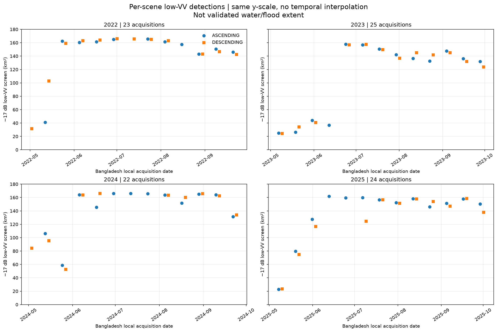
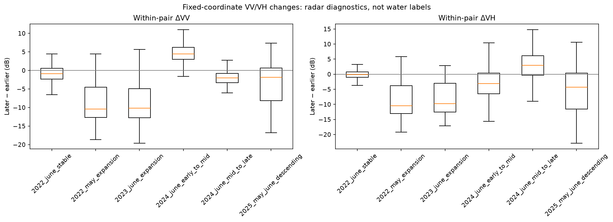
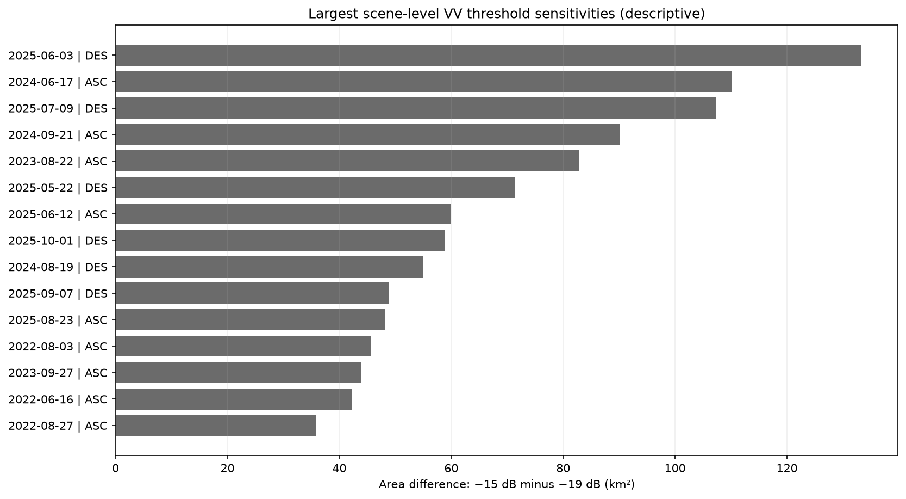
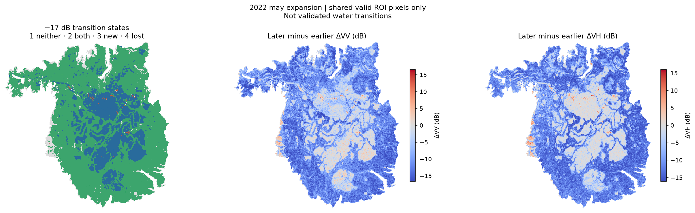
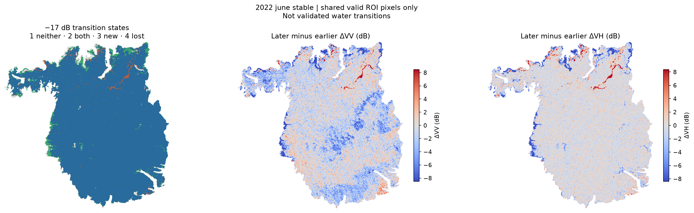
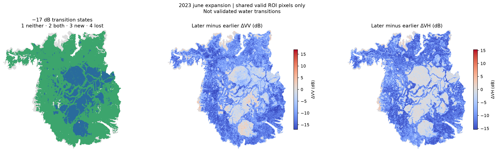
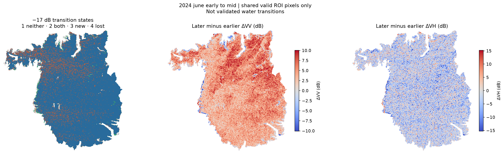
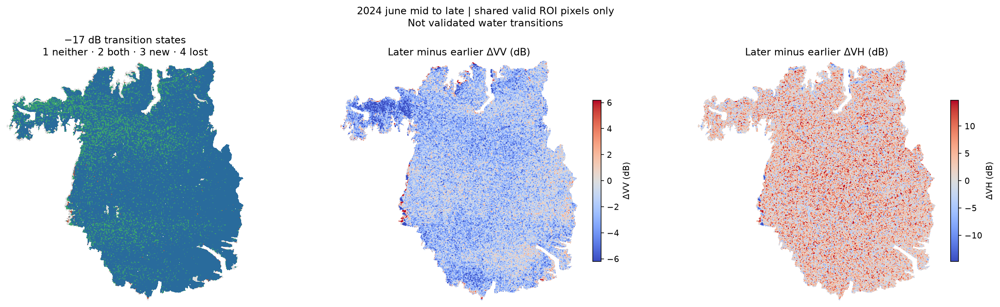
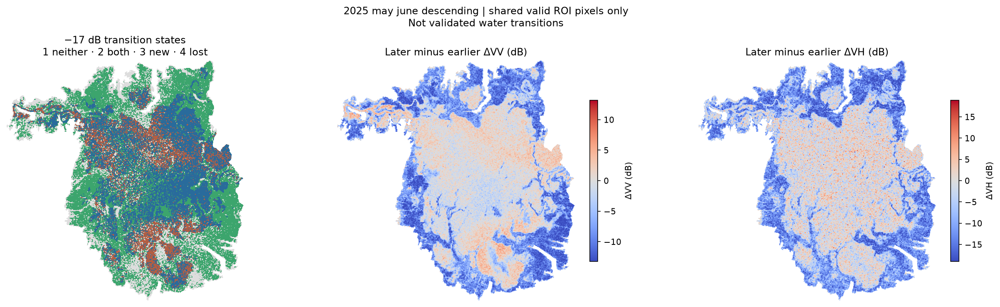
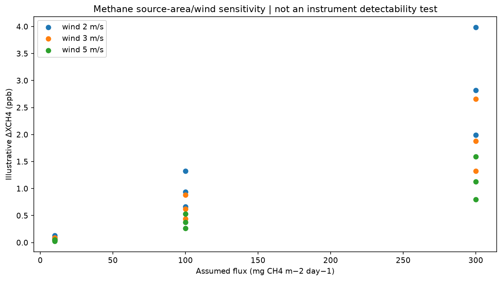

# Hakaluki Haor | Wetland Dynamics, Hydroclimate and Atmospheric Methane Observations

**Study area:** Hakaluki Haor, northeastern Bangladesh · **Main period:** January 2019–December 2025 · **Additional sensor pilot:** ESA Biomass P-band, October 2026

**Data and methods:** Sentinel-1 C-band SAR, Sentinel-2 optical imagery, CHIRPS rainfall, ERA5-Land temperature, Sentinel-5P TROPOMI atmospheric methane (XCH₄), ESA Biomass P-band SAR, Google Earth Engine, Python and GIS.

> **Research status: completed exploratory analyses, not field-validated flood or methane-emission estimates.** Radar “low-VV area” means pixels below a specified backscatter threshold; it is **not a measured flooded area**. TROPOMI XCH₄ is a concentration in the atmospheric column (ppb), **not a surface methane emission rate**. The study-area polygon is an analysis boundary with provenance that still needs independent verification, not a certified regulatory or wetland boundary.

## 1. What this research set out to investigate

Hakaluki Haor changes markedly between the dry season and monsoon. I used multiple satellite records to ask what these changes reveal—and, just as importantly, what the sensors **cannot** establish reliably.

### Research questions

1. **Wetland dynamics:** How does the satellite-observed low-backscatter/wetland signal change through the year and between 2019 and 2025? Can monthly images miss rapid changes?
2. **Rainfall and hydrology:** How do local rainfall, earlier rainfall and temperature relate to those changes? Can rainfall alone explain them, or might upstream river conditions matter?
3. **Flood classification reliability:** How sensitive are SAR results to radar thresholds, polarization, orbit and acquisition date? Can independent optical imagery establish water-class accuracy?
4. **Atmospheric methane:** When can TROPOMI actually observe XCH₄ over the study area, particularly during the monsoon? Do the available observations support conclusions about wetland methane response?
5. **New sensor feasibility:** What additional descriptive information does the October 2026 ESA Biomass P-band observation provide alongside Sentinel-1 and Sentinel-2?

### Objectives and approach

Construct a consistent **84-month (2019–2025)** Earth-observation record; examine monthly seasonality and climate associations; test out-of-year model generalization; reconstruct **per-acquisition** radar changes during 2022–2025; evaluate radiometric and threshold uncertainty using paired spatial maps; audit optical reference-image availability; and separate methane measurement feasibility from actual emission inference.

*Study-area polygon used for analysis. Its exact geographic definition and original boundary provenance have not been independently verified. Most detailed area comparisons use a ~172 km² analysis domain, not all of Hakaluki Haor under every official definition.*

## 2. Important results, in plain language

### Result A — The multi-year satellite signal is strongly seasonal

The consistent ascending Sentinel-1 selection covered **84 of 84 months** in 2019–2025 using **214 acquisitions**. A nominal **−17 dB** VV screen detects much more low-backscatter area in many wet-season months. **This is evidence of changing radar scattering—not automatically of mapped floodwater.** The study area and the fixed threshold limit how much can be concluded about severity.

*Annual frequency is the fraction of **observed** months meeting the screening threshold, not a measured probability of inundation. Full methods: [Notebook 09](notebooks/09_inundation_dynamics_2019_2025_QA_v3_export_fixed.ipynb) · [monthly table](docs/assets/tables/analysis_2019_2025/inundation09_monthly_2019_2025.csv).*

**June comparison: nominal monthly low-VV area and local CHIRPS rainfall**

| June year | VV below −19 dB | VV below −17 dB | VV below −15 dB | Rainfall |
|---|---:|---:|---:|---:|
| **2022** | 148.30 km² | 162.78 km² | 164.77 km² | 1,041.35 mm |
| **2024** | 148.27 km² | 164.88 km² | 167.06 km² | 1,054.26 mm |
| **2025** | 146.48 km² | 161.27 km² | 164.54 km² | 479.17 mm |

**Meaning:** June 2022 was a high-screening month, but **not a uniquely highest June**. The difference between 2022 and 2024 is smaller than the sensitivity to the threshold, and the same low-VV extent can occur with different concurrent local rainfall. These numbers are **not flood-area measurements or damage rankings**.

*The June 2022 **+42.16 km²** spatial statistic is a summed binary-minus-historical-frequency **screening equivalent**, not 42.16 km² of independently confirmed additional floodwater. The separate monthly +42.68 km² statistic uses a different comparator: the median of other Junes.*

### Result B — Rainfall is related to the radar signal, but it does not fully explain it

The 2019–2025 exploratory month-adjusted Spearman correlation between low-VV screening and **previous-three-month rainfall** was **+0.524** on 81 months. This was the strongest of **18** explored relationships, so it is **not a prespecified causal finding**. Same-month rainfall gave +0.232 and previous-month rainfall +0.428.

A climate-based Ridge model **did not consistently beat** a simple seasonal baseline in leave-one-year-out tests:

| Model | MAE (km²; lower is better) | RMSE (km²; lower is better) |
|---|---:|---:|
| Month-median baseline | **13.26** | 19.15 |
| Rainfall/temperature Ridge | 13.65 | **17.45** |

**Meaning:** Rainfall contains useful information, but this model does not reliably predict which year will have an unusual radar signal. Upstream rainfall, river levels, antecedent storage and changing surface scattering remain unresolved.

*These are associations and out-of-year screening-area predictions, not hydrological attribution. [Notebook 10](notebooks/10_hydroclimatic_controls_2019_2025.ipynb) · [model metrics](docs/assets/tables/analysis_2019_2025/hydro10_leave_year_out_model_metrics.csv).*

### Result C — Individual radar acquisitions reveal changes hidden by monthly images

A separate May–September **2022–2025** analysis examined **94 acquisitions** and **86 within-orbit intervals**. Twelve intervals showed changes of at least 20 km² with the **same direction under all three VV thresholds**. Because satellites observe discrete dates, these are observation intervals, not exact flood-onset dates.

Six deliberately selected same-orbit scene pairs were then mapped at a common 30 m grid using only pixels valid in both scenes.

**Net changes in low-VV screening area—not validated inundation change**

| Acquisition pair | −19 dB | −17 dB | −15 dB | Median ΔVV |
|---|---:|---:|---:|---:|
| 11–23 May 2022 | +119.42 km² | **+121.26 km²** | +116.86 km² | −10.17 dB |
| 4–28 June 2022 | +16.50 | +4.38 | +3.91 | −0.99 dB |
| 11–23 June 2023 | +121.91 | **+121.06** | +118.33 | −10.13 dB |
| 5–17 June 2024 | −103.92 | **−18.58** | +0.53 | +4.50 dB |
| 17–29 June 2024 | +90.91 | **+20.55** | +1.45 | −2.00 dB |
| 22 May–3 June 2025, descending | +4.65 | **+42.07** | +66.46 | [Full table](docs/assets/tables/analysis13/13B_paired_spatial_transitions.csv) |

**Meaning:** May 2022 and June 2023 both show large, spatially coherent radar darkening. June 2022 was comparatively steady **after** an earlier May transition. In June 2024 the implied extent loss changes from approximately −104 km² to almost zero depending on the VV cutoff. **That is a warning against interpreting a single radar threshold as water retreat or return.**

**Six paired spatial maps** — Each map shows threshold-class transitions plus continuous changes in VV and VH. “Newly low-VV” and “no longer low-VV” are **screening states**, not validated water changes.

*Source: [scene-level observations](docs/assets/tables/analysis_2019_2025/scene12_S1_per_acquisition_2022_2025.csv) · [18-row paired transition table](docs/assets/tables/analysis13/13B_paired_spatial_transitions.csv) · [13B methods and review](research_docs/reports/ANALYSIS13B_REVIEWED_FINDINGS.md) · [notebooks 12](notebooks/12_scene_level_wetland_dynamics_2022_2025.ipynb), [13A](notebooks/13A_VV_VH_Radiometric_Diagnostics.ipynb), [13B](notebooks/13B_Paired_Spatial_Change_Detection.ipynb), [13C](notebooks/13C_Event_Chronology_Threshold_Robustness.ipynb).*

### Result D — The methane satellite often cannot observe the crucial monsoon months

TROPOMI Level-3-derived XCH₄ values existed within the study area in **69 of 84 months**, but observation availability was uneven:

| Period | Months with XCH₄ |
|---|---:|
| November–April | 42/42 |
| June (2019–2025) | 3/7 |
| July | 2/7 |
| August | 1/7 |

**June 2022 had no valid monthly study-area XCH₄** in this dataset. The main deseasonalized comparison used 66 available months, **49 outside June–October**. Its correlations were close to zero, but mostly represent months where methane observations exist—not reliable evidence that flooding has no effect on emissions.

An additional 13F calculation considered **27 hypothetical combinations** of source strength, emitting area and wind speed. The modeled atmospheric enhancement is a **scenario**, not a measured plume or emission rate.

*Meaning: the methane question remains unresolved primarily because of limited wet-season measurement support and missing flux/transport evidence. [Notebook 11](notebooks/11_tropomi_methane_qa_2019_2025.ipynb) · [methane availability table](docs/assets/tables/analysis_2019_2025/methane11_monthly_availability.csv) · [13F scenarios](docs/assets/tables/analysis13/13F_hypothetical_flux_to_XCH4_scenario_screen.csv).*

### Result E — Independent satellite-reference feasibility was assessed, not classification accuracy

The 13E analysis searched nearby Sentinel-2 images and assessed usable optical observations at **550 fixed diagnostic coordinates**. Same-date tile overlap was deduplicated by point ID rather than summing tile counts. The best screened optical candidates covered **roughly 16–47%** of those points for several dates; **17 June 2024 and 3 June 2025 had no eligible points** among the screened candidates. Some other dates had better partial coverage.

**Meaning:** Cloud cover and tile coverage limit independent optical checking in the monsoon. No independently interpreted water/non-water reference labels or confusion matrix were completed. **There is no defensible water-class accuracy percentage to report.**

*Evidence: [Sentinel-2 same-date tile-union QA](docs/assets/tables/analysis13/13E_S2_same_date_tile_union_QA.csv) · [13E notebook](notebooks/13E_Independent_Satellite_Validation.ipynb) · [continuation](notebooks/13E_continue_tile_union_and_reference_design.ipynb).*

### Result F — ESA Biomass P-band imagery adds a separate, descriptive sensor experiment (October 2026)

The pilot processed a **2 October 2026** fully polarimetric ESA Biomass P-band acquisition (HH/HV/VH/VV), alongside **30 September 2026** Sentinel-1 C-band and **7 October 2026** Sentinel-2 imagery. Four 25 m Gamma0 P-band polarization layers were examined and compared descriptively with the other sensors.

The example within-sensor median contrasts were about **8.16 dB** (P-band HH–HV) and **11.00 dB** (C-band VV–VH). These compare *different polarization combinations*, not classification accuracy. Optical MNDWI groups were also descriptive; they were not independently validated water classes.

**Meaning:** P-band processing and multi-sensor visualization are feasible, but **no sensor-superiority or validated flooded-vegetation claim** follows from these observations on different dates.

*Data: [polarization contrasts](docs/assets/tables/biomass_2026/biomass_08W_polarization_contrasts.csv) · [cross-sensor statistics](docs/assets/tables/biomass_2026/biomass_08W_cross_sensor_statistics.csv) · [processor comparison](docs/assets/tables/biomass_2026/biomass_08S_matched_gamma0_processor_comparison.csv).*

## 3. Limitations — and why they matter

| Limitation | Why it matters, in simple language |
|---|---|
| **No independent water-class reference labels** | Dark radar pixels can be open water, wet ground or other surfaces. We cannot report reliable flooded area, accuracy or flood severity. |
| **Study-area boundary has uncertain provenance** | The selected polygon is an analysis window, not necessarily the full wetland or an official administrative/ECA outline; total-area comparisons depend on this choice. |
| **Radar thresholds and observation geometry** | Changing the VV cutoff from −19 to −15 dB can reverse the apparent direction of an event. Ascending and descending passes must not be assumed interchangeable. |
| **Acquisitions occur on separate days** | Large changes between scenes do not tell us the exact onset date, maximum water level or duration between observations. |
| **Incomplete upstream hydrology** | Local rainfall alone cannot distinguish catchment inflow, river backwater, storage and other processes. No suitable historical gauge-based stage–area analysis was completed. |
| **Cloudy optical reference images** | Some critical monsoon dates cannot be independently checked using the Sentinel-2 observations examined. |
| **Sparse monsoon methane data** | Missing XCH₄ retrievals mean a weak available-month correlation cannot establish the wet-season methane response. |
| **XCH₄ is not emission flux** | Atmospheric concentration also depends on wind, transport, retrieval error and other sources. A hypothetical box model is not a methane measurement. |
| **P-band and C-band images differ in date, geometry and polarization** | Descriptive differences cannot show that one satellite is better at detecting flooding without matched reference labels. |
| **Exploratory models and limited years** | Correlations selected after comparison and seven held-out years do not guarantee causal relationships or reliable prediction in new events. |

**The main research conclusion:** Satellite radar reveals large seasonal and event-scale changes at Hakaluki Haor, but the numerical “low-backscatter extent” is not the same as independently verified inundation. Rainfall associations, methane observations and P-band comparisons are informative only within these measurement limits.

## 4. Research materials and reproducibility

| Component | Notebooks | Data and figures |
|---|---|---|
| Study-area setup and earlier workflows | [00–08 folder](notebooks/) | [Boundary documentation](data/boundary/BOUNDARY_README.md) |
| 2019–2025 monthly radar screening | [09](notebooks/09_inundation_dynamics_2019_2025_QA_v3_export_fixed.ipynb) | [Tables](docs/assets/tables/analysis_2019_2025/) · [Figures](docs/assets/figures/analysis_2019_2025/) |
| Hydroclimate and held-out evaluation | [10](notebooks/10_hydroclimatic_controls_2019_2025.ipynb) | [Full findings](research_docs/FINDINGS_2019_2025_AND_LIMITATIONS.md) |
| Atmospheric methane QA | [11](notebooks/11_tropomi_methane_qa_2019_2025.ipynb) | [QA manifest](docs/assets/tables/analysis_2019_2025/methane11_qa_manifest.json) |
| Scene-level acquisition dynamics | [12](notebooks/12_scene_level_wetland_dynamics_2022_2025.ipynb) | [94-scene table](docs/assets/tables/analysis_2019_2025/scene12_S1_per_acquisition_2022_2025.csv) |
| Radiometry, paired maps and chronology | [13A–13C](notebooks/) | [Tables](docs/assets/tables/analysis13/) · [Figures](docs/assets/figures/analysis13/) |
| Hydrology, reference feasibility, methane scenarios | [13D–13F](notebooks/) | [Availability and scenario outputs](docs/assets/tables/analysis13/) |
| ESA Biomass 2026 pilot | [08 feasibility workflow](notebooks/08_biomass_pband_feasibility.ipynb) | [Biomass data](docs/assets/tables/biomass_2026/) · [Figures](docs/assets/figures/biomass_2026/) |

**Documentation:** [Detailed results and non-findings](research_docs/FINDINGS_2019_2025_AND_LIMITATIONS.md) · [Methods and limitations](research_docs/METHODS_AND_LIMITATIONS.md) · [Data provenance](research_docs/DATA_DICTIONARY_AND_PROVENANCE.md) · [Analysis 13 publication status](research_docs/reports/ANALYSIS13_PUBLICATION_STATUS.md).

The repository retains earlier exploratory outputs for **traceability**, including maps made with older screening definitions. They are not interchangeable with the corrected Notebook 09 or per-scene Analysis 13 products. The presence of code and results does not mean the study has been independently reproduced or scientifically validated.
